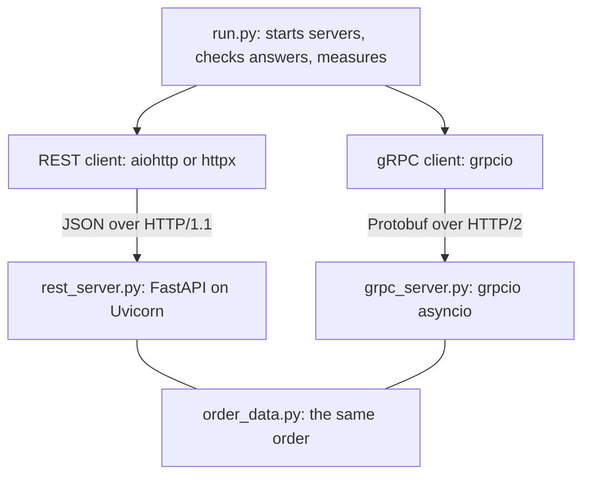

# Benchmark: REST vs gRPC, full call

Is Protobuf the better approach? This benchmark measures the whole "get order 42" call, not only the format.

- **REST:** FastAPI server on Uvicorn, JSON over HTTP/1.1. The route declares its return type, so Pydantic writes the JSON. The access log is off.
- **gRPC:** grpcio asyncio server, Protobuf over HTTP/2, with protobuf's default `upb` backend. The script checks for that backend.
- **Same data:** both servers return the same order, from [order_data.py](order_data.py). The schema is [order.proto](order.proto). Before timing, the script checks that every client gets the same order back.
- **Two REST clients:** aiohttp and httpx. The client turned out to matter as much as the protocol.

## What "better" means

| Question | Measured as | In real life |
|---|---|---|
| How fast is one call? | Latency (p50, p99) | One customer, one order: how long until the food arrives? |
| How many calls can one server handle? | Calls per second | A packed restaurant: how many meals per hour? |
| How hard does the computer work? | CPU µs per call | How much effort the cook puts into each plate |
| How much crosses the network? | Wire bytes per call | How heavy the delivery box is |



## The files

| File | What it does |
|---|---|
| [order.proto](order.proto) | The schema gRPC needs: messages with field numbers, and the `GetOrder` call. `run.py` generates Python code from it on its first run. |
| [order_data.py](order_data.py) | The same order for both servers, with 2, 100 or 1,000 items. |
| [rest_server.py](rest_server.py) | FastAPI route `GET /orders/{id}?items=N`. Its return type makes Pydantic, which is written in Rust, write the JSON. |
| [grpc_server.py](grpc_server.py) | grpcio asyncio server with the same `GetOrder`. |
| [run.py](run.py) | The referee: starts both servers, checks the answers, measures, and prints the table. |

Both servers build each order once and cache it. So the benchmark measures sending an order, not building it. A real app would read a database at that point, which costs the same for both styles.

## How it measures

The scenarios follow [grpc.io's benchmarking guide](https://grpc.io/docs/guides/benchmarking/):

1. **Latency:** one call at a time on one warm connection, 5,000 calls after 500 warm-up calls. We report the median (p50) and the 99th percentile (p99).
2. **Throughput:** 64 calls in flight for 5 seconds. They come from 4 client processes with 16 each, so the client is not the limit. grpc.io also uses separate client machines for this.
3. **CPU per call:** the server's and the clients' CPU time during the throughput run, divided by the number of calls.
4. **Bytes on the wire:** a small TCP proxy counts the bytes in each direction for 200 calls on a warm connection. That covers HTTP headers plus body, but not TCP/IP headers.

Each server is one process. The gRPC client reuses one channel, as grpc.io's [performance guide](https://grpc.io/docs/guides/performance/) advises.

What `run.py` does, in order:

1. Generates `order_pb2.py` and `order_pb2_grpc.py` from `order.proto` if they are missing.
2. Stops unless protobuf uses its `upb` backend. The pure-Python backend is 3–5× slower than JSON (see [request_encode_speed.py](../../examples/communication/request_encode_speed.py)).
3. Starts both servers as separate processes, then waits until each one accepts connections.
4. Asks every client for every size and checks that the answer equals `make_order(42, n)`. A server that sends different data would make the race unfair.
5. For each size and each client, it measures latency, throughput with CPU, and wire bytes. Warm-up calls come first, because the first calls open connections and fill caches.
6. Stops the servers, even if something failed.

**p50 and p99:** sort all 5,000 times. The middle one is p50, a typical call. The one 99% of the way along is p99: 1 call in 100 is slower than that.

## A lesson from building it: check who is busy

The first version used one client process with httpx. REST got only 768 calls per second, while its server was only about 8% busy. If the kitchen is idle and orders are still slow, the waiter is the problem, not the kitchen.

Testing the two REST clients alone showed it:

| Client | p50 | Calls/s (64 in flight, one process) | Client CPU per call |
|---|---|---|---|
| httpx | 600 µs | 727 | 1,073 µs |
| aiohttp | 156 µs | 17,366 | 49 µs |

So the benchmark now spreads the load over 4 client processes (one Python process uses about one core), and it reports both REST clients. When a benchmark result looks odd, measure the client as well as the server.

## Results

Measured on 2026-11-24: Apple M1 Pro (8 cores), macOS 26.5.2, Python 3.12.4, and the versions in [requirements.txt](requirements.txt). Client and servers ran on the same machine, over localhost. A second full run agreed within about 1% on p50 and 5% on calls per second.

| Message | Style | Body bytes | Wire bytes per call (up / down) | p50 µs | p99 µs | Calls/s | Server CPU µs per call | Client CPU µs per call |
|---|---|---|---|---|---|---|---|---|
| small (2 items) | REST, aiohttp client | 143 | 143 / 269 | 157 | 305 | 16,421 | 60 | 90 |
| small (2 items) | REST, httpx client | 143 | 160 / 269 | 598 | 1,186 | 2,428 | 119 | 1,270 |
| small (2 items) | gRPC | 40 | 61 / 104 | 350 | 523 | 6,495 | 236 | 195 |
| medium (100 items) | REST, aiohttp client | 4,456 | 145 / 4,583 | 205 | 320 | 12,647 | 78 | 126 |
| medium (100 items) | REST, httpx client | 4,456 | 162 / 4,583 | 653 | 1,107 | 2,077 | 145 | 1,489 |
| medium (100 items) | gRPC | 1,511 | 61 / 1,575 | 360 | 526 | 6,214 | 244 | 207 |
| large (1,000 items) | REST, aiohttp client | 44,057 | 146 / 44,185 | 703 | 1,237 | 4,204 | 236 | 485 |
| large (1,000 items) | REST, httpx client | 44,057 | 163 / 44,185 | 1,120 | 1,689 | 1,528 | 306 | 2,043 |
| large (1,000 items) | gRPC | 15,011 | 62 / 15,075 | 447 | 614 | 5,674 | 255 | 229 |

## What it shows

- **Bytes:** gRPC always sends fewer. The Protobuf body is about 3× smaller at every size. The headers are smaller too, because HTTP/2 compresses them: a small call is 104 bytes down for gRPC and 269 for REST.
- **Small and medium messages:** REST with aiohttp was faster. Its p50 was 157 vs 350 µs, and it handled 2.5× the calls per second. Here the time goes to the framework, not the format. The grpcio server used about 4× more CPU per call than FastAPI.
- **Large messages:** gRPC was faster, with a p50 of 447 vs 703 µs and 1.35× the calls per second. gRPC's cost barely grows with size, because Protobuf encoding is cheap. REST's cost grows with the JSON.
- **The client matters:** with httpx as the REST client, gRPC wins at every size. httpx used 1,270–2,043 µs of client CPU per call; aiohttp used 90–485 µs.
- **Over a real network** (derived, not measured): sending the large response's bytes at 10 Mbit/s takes about 35 ms for REST and 12 ms for gRPC. At that point the bytes count far more than the microseconds above. Every call also pays the network round trip, which is the same for both.

**So is Protobuf better?** It is always smaller on the wire. In Python on one machine, it is faster end to end only for large messages, or when the REST client is slow. For small messages, the framework costs more than the format.

## Limits

- One machine over localhost, so there is no real network delay or bandwidth limit. Clients and servers share the CPU.
- Python only. grpc.io benchmarks other languages, and their results will differ.
- One server process each, with no TLS, no compression and unary calls only. REST is not tried over HTTP/2 or with `orjson`.
- gRPC's sync thread-pool server was also tried in a quick run. It gave about the same calls per second, a lower small-message p50 (269 µs) and a worse large-message p99. The asyncio server is kept, as grpc.io advises.

## Run it

```bash
python3 -m venv .venv
.venv/bin/pip install -r requirements.txt
.venv/bin/python run.py           # about two minutes
.venv/bin/python run.py --quick   # smoke test
```

`run.py` generates the gRPC code from `order.proto` on its first run, starts both servers on ports 8011 and 50061, and prints the table.

## Try it yourself

1. Run `run.py --quick` and compare your numbers with the table above.
2. Set `CLIENT_PROCESSES, IN_FLIGHT_EACH = 1, 64` in `run.py`. REST with httpx collapses, because the client becomes the limit.
3. Add `"huge (10,000 items)": 10000` to `SIZES`. Does gRPC's lead grow?
4. Remove `--no-access-log` from the uvicorn command and see what logging costs per call.
