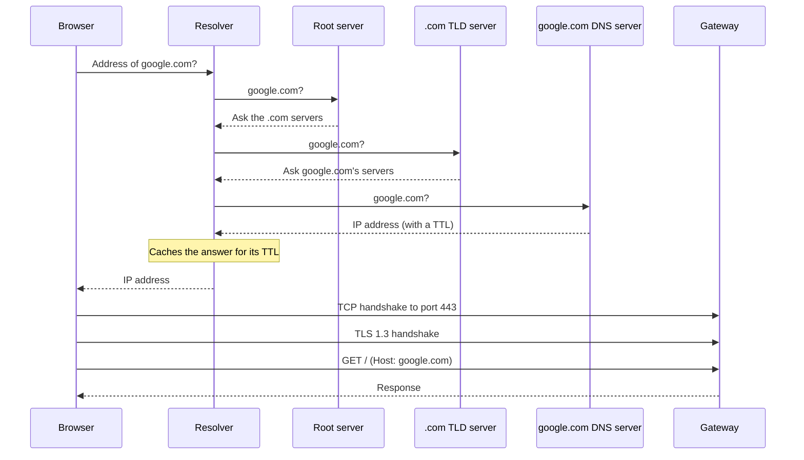

# How a request travels

## The problem
You type `google.com` and a page appears.
Your browser has to find the server, connect to it securely, and ask for the page.

## The picture



## How it works
1. **Your address.** Your laptop has a private IP (Internet Protocol) address, like `192.168.1.20`. It only means something inside your home network.
2. **NAT (Network Address Translation).** Your router swaps that private address and port for its own public address and a new port. It remembers the swap so replies find their way back.
3. **The name exists.** Someone bought `google.com` from a [registrar](https://www.icann.org/resources/pages/domain-name-registration-process-2023-11-02-en). The `.com` registry points the name to Google's DNS (Domain Name System) servers.
4. **Ask a resolver.** Your OS has a small stub resolver. It hands the question to a recursive resolver.
5. **Walk the tree.** If the answer isn't cached, the resolver asks a root server. The root points to the `.com` TLD (top-level domain) servers, and they point to Google's own DNS servers.
6. **Cache with a TTL (time to live).** Google's server returns the IP address. Every resolver caches it for its TTL, in seconds.
7. **TCP (Transmission Control Protocol).** The browser connects to that IP on port 443, the standard port for secure web traffic (HTTPS). It takes three packets: SYN, SYN-ACK, ACK.
8. **TLS (Transport Layer Security).** The browser and server agree on keys, and the server proves who it is with a certificate. In TLS 1.3 this takes one round trip.
9. **HTTP (Hypertext Transfer Protocol).** The browser sends `GET /` with a `Host: google.com` header.
10. **The front door.** The address usually belongs to a gateway, not the final server. The gateway forwards the request to one of many servers behind it. This is how load balancing works.
11. **The way back.** The response returns along the same path. Your router uses its NAT record to hand it to your laptop.

## In our code
None yet. The auth service in M2 is where the request lands: [auth_service](../../project/foodpanda/services/auth_service/).

## Try it
Run these in a terminal. Each one shows part of the picture.

1. **DNS:** `dig google.com +trace` shows the walk: the root servers, then the `.com` servers, then Google's servers, then the address with its TTL.
   - If it stops at `Received 17 bytes`, the reply was empty: a device on your network answered in the root server's place. Ask [a root server](https://www.iana.org/domains/root/servers) directly, over TCP:

     ```bash
     dig +trace +tcp @198.41.0.4 google.com
     ```

2. **TCP, TLS and HTTP:** `curl -v https://google.com`. Look for these lines:
   - `Connected to google.com (<IP>) port 443`: the TCP connection (step 7).
   - `TLS handshake` and `SSL connection using TLSv1.3`: step 8. A `(304)` on those lines is not an HTTP status: it is how [curl prints](https://github.com/curl/curl/blob/curl-8_7_1/lib/vtls/openssl.c) the TLS version number 0x0304, which means TLS 1.3.
   - `ALPN: server accepted h2`: inside the TLS handshake, ALPN (Application-Layer Protocol Negotiation) picked HTTP/2.
   - `:method: GET`, `:path: /`, `:authority: google.com`: HTTP/2's way of writing `GET /` and `Host: google.com` (step 9).
   - `HTTP/2 301` and `location: https://www.google.com/`: google.com answers "moved to `www.google.com`". A browser follows it and asks `www.google.com` for the page.
3. **The path:** `traceroute google.com` lists each router on the way, with three round-trip times per hop (three probes). The first hop is your home router, at a private address.

## Remember
- DNS turns a name into an IP address, and the answer is cached for its TTL.
- TCP opens a connection, then TLS secures it, then HTTP sends the request.
- You usually reach a gateway first. It spreads requests across many servers.

## Sources
- [RFC 1918: private addresses](https://www.rfc-editor.org/rfc/rfc1918)
- [RFC 3022: traditional NAT](https://www.rfc-editor.org/rfc/rfc3022)
- [ICANN: the domain name registration process](https://www.icann.org/resources/pages/domain-name-registration-process-2023-11-02-en)
- [RFC 1034: DNS concepts](https://www.rfc-editor.org/rfc/rfc1034)
- [RFC 1035: DNS implementation](https://www.rfc-editor.org/rfc/rfc1035)
- [RFC 9499: DNS terminology](https://www.rfc-editor.org/rfc/rfc9499)
- [RFC 9293: TCP](https://www.rfc-editor.org/rfc/rfc9293)
- [RFC 8446: TLS 1.3](https://www.rfc-editor.org/rfc/rfc8446) and [RFC 7301: ALPN](https://www.rfc-editor.org/rfc/rfc7301)
- [RFC 9110: HTTP semantics](https://www.rfc-editor.org/rfc/rfc9110) and [RFC 9113: HTTP/2](https://www.rfc-editor.org/rfc/rfc9113)
- Tools: [IANA Root Servers](https://www.iana.org/domains/root/servers), [curl manual](https://curl.se/docs/manpage.html), [curl source, `openssl.c`](https://github.com/curl/curl/blob/curl-8_7_1/lib/vtls/openssl.c); `man dig`, `man traceroute`
- Full research notes: [how-a-request-travels.md](../research/how-a-request-travels.md)

