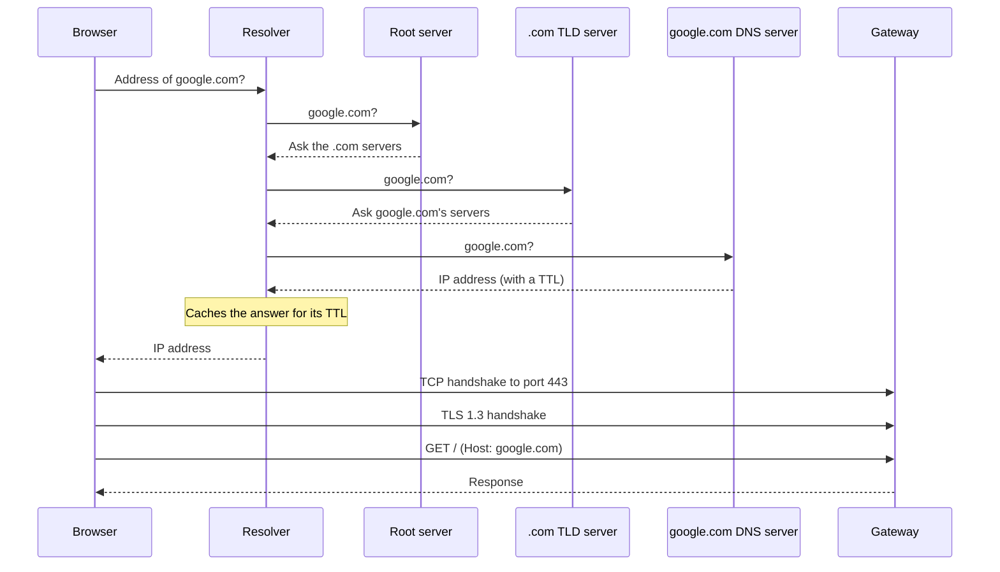

# How a request travels

## The problem
You type `google.com` and a page appears.
Your browser has to find the server, connect to it securely, and ask for the page.

## The picture

Step through it: [interactive version](../../html/00-foundations/01-how-a-request-travels.html).

## How it works
1. **Your address.** Your laptop has a private IP address, like `192.168.1.20`. It only means something inside your home network. [RFC 1918 §3]
2. **NAT.** Your router swaps that private address and port for its own public address and a new port. It remembers the swap so replies find their way back. [RFC 3022 §2.2, §3.1]
3. **The name exists.** Someone bought `google.com` from a registrar. The `.com` registry points the name to Google's DNS servers. [ICANN](https://www.icann.org/resources/pages/domain-name-registration-process-2023-11-02-en); [RFC 1034 §4.2]
4. **Ask a resolver.** Your OS has a small stub resolver. It hands the question to a recursive resolver. [RFC 1034 §5.3.1]
5. **Walk the tree.** If the answer isn't cached, the resolver asks a root server. The root points to the `.com` servers, and they point to Google's own DNS servers. [RFC 1034 §5.3.3; RFC 9499 §4]
6. **Cache with a TTL.** Google's server returns the IP address. Every resolver caches it for its TTL, in seconds. [RFC 1035 §3.2.1]
7. **TCP.** The browser connects to that IP on port 443, the HTTPS port. It takes three packets: SYN, SYN-ACK, ACK. [RFC 9293 §3.5; RFC 9110 §4.2.2]
8. **TLS.** The browser and server agree on keys, and the server proves who it is with a certificate. In TLS 1.3 this takes one round trip. [RFC 8446 §2]
9. **HTTP.** The browser sends `GET /` with a `Host: google.com` header. [RFC 9110 §9.3.1, §7.2]
10. **The front door.** The address usually belongs to a gateway, not the final server. The gateway forwards the request to one of many servers behind it. This is how load balancing works. [RFC 9110 §3.7]
11. **The way back.** The response returns along the same path. Your router uses its NAT record to hand it to your laptop. [RFC 3022 §3.2]

## In our code
None yet. The auth service in M2 is where the request lands: [auth_service](../../project/foodpanda/services/auth_service/).

## Try it
- `dig google.com +trace`: shows the walk from the root to `.com` to Google. Some networks block it.
- `curl -v https://google.com`: shows the IP and port 443, then TLS 1.3, then `GET /` and the response.
- `traceroute google.com`: shows each router your packets pass through.

## Remember
- DNS turns a name into an IP address, and the answer is cached for its TTL.
- TCP opens a connection, then TLS secures it, then HTTP sends the request.
- You usually reach a gateway first. It spreads requests across many servers.

## Sources
- [RFC 1918: private addresses](https://www.rfc-editor.org/rfc/rfc1918)
- [RFC 3022: traditional NAT](https://www.rfc-editor.org/rfc/rfc3022)
- [ICANN: the domain name registration process](https://www.icann.org/resources/pages/domain-name-registration-process-2023-11-02-en)
- [RFC 1034: DNS concepts](https://www.rfc-editor.org/rfc/rfc1034)
- [RFC 1035: DNS implementation](https://www.rfc-editor.org/rfc/rfc1035)
- [RFC 9499: DNS terminology](https://www.rfc-editor.org/rfc/rfc9499)
- [RFC 9293: TCP](https://www.rfc-editor.org/rfc/rfc9293)
- [RFC 8446: TLS 1.3](https://www.rfc-editor.org/rfc/rfc8446)
- [RFC 9110: HTTP semantics](https://www.rfc-editor.org/rfc/rfc9110)
- Full research notes: [how-a-request-travels.md](../research/how-a-request-travels.md)

## Animation script
1. A laptop with a private IP sits behind a router. NAT swaps it for the router's public IP.
2. The browser asks the stub resolver for `google.com`.
3. Cache miss: the recursive resolver asks root, then the `.com` TLD, then Google's DNS server.
4. The IP comes back and is cached with its TTL.
5. TCP three-way handshake to port 443.
6. TLS 1.3 handshake, one round trip.
7. HTTP `GET /` with `Host: google.com`.
8. The gateway receives it and forwards it to one of many servers.
9. The response travels back, and NAT hands it to the laptop.
