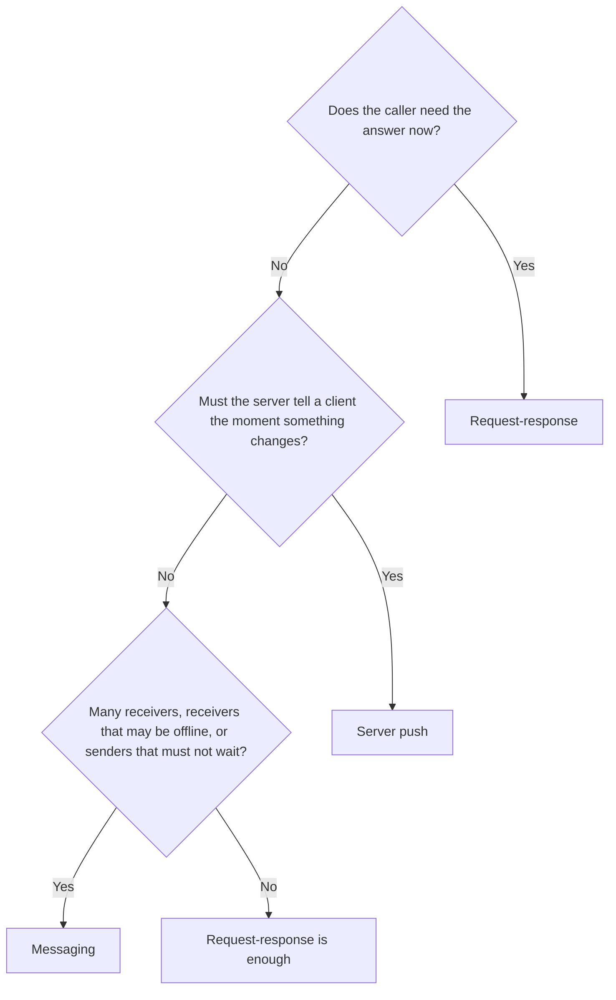

# Communication styles: request-response, server push, messaging

## The problem
Two programs need to exchange messages. microservices.io calls this choice the **communication style**. [microservices.io, RPI; microservices.io, Messaging]
The picture below picks a group with three questions. The questions are ours, not from a source.

## The picture

## The three groups

### Request-response
- **In real life:** you give the waiter your order and wait at your table until the dish comes.
- The client sends a request and waits for the reply. Examples: gRPC ("gRPC Remote Procedure Calls"), REST (Representational State Transfer). [microservices.io, RPI; grpc.io FAQ]
- microservices.io calls this group Remote Procedure Invocation (RPI). [microservices.io, RPI]
- Cost: both sides must be up for the whole call. [microservices.io, RPI]
- Page: [API styles: GraphQL, gRPC, REST](01-api-styles.md). API means Application Programming Interface.

### Server push
- **In real life:** the counter hands you a pager, and it buzzes when your food is ready. You don't keep asking.
- The server sends a message to a client the moment something happens, without a new request.
- Examples: SSE (Server-Sent Events), webhooks, WebRTC (Real-Time Communication in Browsers), WebSocket.
- WebRTC is peer-to-peer: a server helps set up the call, then the two ends connect to each other. [W3C WebRTC §4.1; RFC 9429 §1.1]
- This group name is ours; no source names it.
- Page: "Server push" (coming).

### Messaging
- **In real life:** the waiter pins order tickets on the kitchen rail and goes back to the tables. Each cook takes the next ticket when free.
- Programs send messages through a channel, usually a broker. The sender doesn't wait for the receiver. Examples: Apache Kafka, RabbitMQ. [microservices.io, Messaging]
- Gain: the broker holds messages until the receiver is ready, so either side can be down for a while. [microservices.io, Messaging]
- Cost: the broker is one more system, and it must be highly available. [microservices.io, Messaging]
- Skip it when plain calls already meet your needs. [Azure, Event-driven architecture style]
- Page: "Messaging" (coming).

## All 15, by group

| Item | What it is, per its own source | Group |
|---|---|---|
| GraphQL | A query language and execution engine | Request-response |
| gRPC | An RPC (Remote Procedure Call) framework | Request-response |
| MCP (Model Context Protocol) | An open protocol for AI (artificial intelligence) apps, built on JSON-RPC 2.0 (JavaScript Object Notation RPC) | Request-response |
| REST | An architectural style | Request-response |
| RPC | The remote procedure call model: a family, not one protocol | Request-response |
| SOAP (no longer an acronym) | A protocol for exchanging structured information | Request-response |
| SSE | A browser interface plus the `text/event-stream` format | Server push |
| Webhooks | HTTP (Hypertext Transfer Protocol) callbacks from one service to another | Server push |
| WebRTC | Browser APIs plus protocols for peer-to-peer media and data | Server push (peer-to-peer) |
| WebSocket | A two-way protocol over TCP (Transmission Control Protocol) | Server push |
| AMQP (Advanced Message Queuing Protocol) | A binary wire-level protocol for business messaging | Messaging |
| Apache Kafka | An event streaming platform | Messaging |
| Event-driven architecture | An architecture style: producers, consumers and channels | Messaging |
| MQTT (Message Queuing Telemetry Transport) | A publish/subscribe messaging transport protocol | Messaging |
| AsyncAPI | A specification that describes message-driven APIs; not a way to send messages | Describes APIs |

Every row is cited in the [research note, §7](../../research/communication-styles.md#7-classification-of-the-15-derived-from-15).

## Surprises
- Core SOAP has no reliable delivery. SOAP 1.2 leaves it out on purpose; WS-ReliableMessaging (Web Services Reliable Messaging) is a separate spec. [SOAP 1.2 Part 1 §1; WS-ReliableMessaging 1.2]
- WebRTC is peer-to-peer, but it still needs your server. The app must carry the setup messages (signaling) itself, and a TURN server (Traversal Using Relays around NAT; NAT is Network Address Translation) relays traffic when a direct path fails. [RFC 9429 §1.1; RFC 8656]
- SSE can break behind old proxies that drop idle connections. The spec advises sending a comment line about every 15 seconds. [HTML Living Standard §9.2.7]
- AMQP 1.0 and AMQP 0-9-1 are different protocols despite the name: they share "nothing at the wire level". RabbitMQ was built for 0-9-1. [RabbitMQ, Protocols]

## Remember
- Request-response: the caller waits, so both sides must be up.
- Server push: the server speaks first, to a client it already knows.
- Messaging: a broker sits in between, so senders and receivers don't wait for each other.

## Sources
- [microservices.io: Remote Procedure Invocation](https://microservices.io/patterns/communication-style/rpi.html) and [Messaging](https://microservices.io/patterns/communication-style/messaging.html)
- [Enterprise Integration Patterns: Integration Styles](https://www.enterpriseintegrationpatterns.com/patterns/messaging/IntegrationStylesIntro.html)
- [Fielding 2000, chapter 5: REST](https://ics.uci.edu/~fielding/pubs/dissertation/rest_arch_style.htm), [grpc.io: About](https://grpc.io/about/), [GraphQL specification](https://spec.graphql.org/September2026/)
- [SOAP 1.2 Part 1](https://www.w3.org/TR/soap12-part1/) and [WS-ReliableMessaging 1.2](http://docs.oasis-open.org/ws-rx/wsrm/200702/wsrm-1.2-spec-os.html)
- [RFC 5531: RPC](https://www.rfc-editor.org/rfc/rfc5531), [JSON-RPC 2.0](https://www.jsonrpc.org/specification), [MCP specification](https://modelcontextprotocol.io/specification/latest)
- [Standard Webhooks](https://www.standardwebhooks.com/), [HTML: Server-sent events](https://html.spec.whatwg.org/multipage/server-sent-events.html), [RFC 6455: WebSocket](https://www.rfc-editor.org/rfc/rfc6455)
- [W3C WebRTC](https://www.w3.org/TR/webrtc/), [RFC 9429: JSEP](https://www.rfc-editor.org/rfc/rfc9429), [RFC 8656: TURN](https://www.rfc-editor.org/rfc/rfc8656)
- [Azure: Event-driven architecture style](https://learn.microsoft.com/en-us/azure/architecture/guide/architecture-styles/event-driven)
- [MQTT 5.0](https://docs.oasis-open.org/mqtt/mqtt/v5.0/mqtt-v5.0.html), [AMQP 1.0](https://docs.oasis-open.org/amqp/core/v1.0/os/amqp-core-overview-v1.0-os.html), [RabbitMQ: Protocols](https://www.rabbitmq.com/docs/protocols), [Apache Kafka: Introduction](https://kafka.apache.org/intro)
- [AsyncAPI 3.1.0](https://www.asyncapi.com/docs/reference/specification/latest)
- Full research note: [communication-styles.md](../../research/communication-styles.md)
