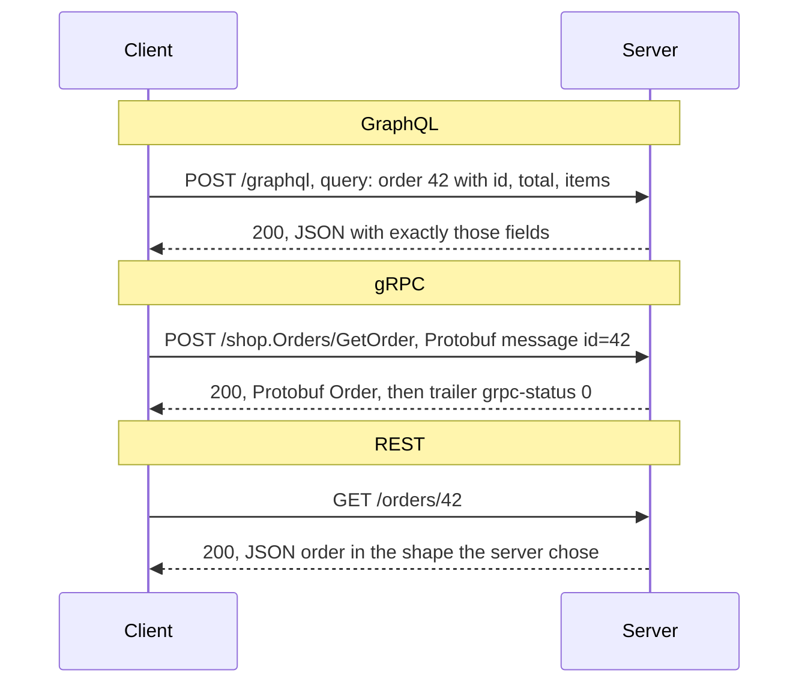

# API styles: GraphQL, gRPC, REST

## The problem
A client asks a server for work and waits for the answer. This is [request-response](00-overview.md).
An API (Application Programming Interface) style is the shape of those calls: how you name the work, and what the answer looks like.

Two terms first:
- **HTTP API**: any API whose messages travel over HTTP (Hypertext Transfer Protocol). All three styles below can run over HTTP, so this is the umbrella, not an option. [OpenAPI §2]
- **REST (Representational State Transfer), strictly**: Roy Fielding, who defined REST, says an API not driven by links in its responses "cannot be RESTful". Most APIs called REST skip the links. This page uses "REST" in the everyday sense. [Fielding 2008]

## The options

### GraphQL
- **What it is:** "a query language and execution engine". The client sends one document to one endpoint, usually `/graphql`, and names the fields it wants. [GraphQL spec, Introduction; graphql.org, Serving over HTTP]
- **Pros:** the answer holds exactly the requested fields, "avoiding over-fetching and under-fetching". One typed schema that clients can query. New fields need no new version. [GraphQL spec §2.5, §4; graphql.org, Schema Design]
- **Cons:** a naive server makes one data call for a list, then one more per item (the N+1 problem). Public APIs need depth, breadth and rate limits. Most HTTP caches skip POST. [graphql.org, Performance; graphql.org, Security; RFC 9110 §9.2.3]
- **Use when:** front ends need flexible data shapes, or one gateway sits in front of many services. [GraphQL spec §1; graphql.org FAQ]

### gRPC
- **What it is:** an RPC (Remote Procedure Call) framework. The client calls a server method "as if it were a local object", over HTTP/2, with Protobuf (Protocol Buffers) messages by default. The name stands for "gRPC Remote Procedure Calls". [grpc.io Introduction; grpc.io FAQ]
- **Pros:** one `.proto` file generates clients and servers in many languages. Four call kinds: unary, server streaming, client streaming, bidirectional. Deadlines and cancellation are built in. [grpc.io Python Basics; grpc.io Core concepts]
- **Cons:** browsers need gRPC-Web and a proxy, without client or bidirectional streaming. A message can't be fully read without its `.proto` file: the bytes hold field numbers, not names. No deadline unless you set one. [grpc-web README; protobuf.dev Overview; protobuf.dev Encoding; grpc.io Deadlines]
- **Use when:** services in many languages talk to each other, or mobile clients talk to cloud servers. [grpc.io About; grpc.io FAQ]

### REST
- **What it is:** REST is an architectural style. Each resource has a URI (Uniform Resource Identifier); clients use standard HTTP methods such as GET and POST on it. [Fielding 2000 ch. 5; RFC 9110 §9.1]
- **Pros:** browsers, proxies and shared caches can store GET responses. Standard methods tell clients which requests are safe to retry. FastAPI generates an OpenAPI contract at `/openapi.json`. [RFC 9111 §2; RFC 9110 §9.2.2; FastAPI First Steps]
- **Cons:** the standard form "degrades efficiency". The server decides the shape of each response. It is pull-only, so watching for changes costs more. [Fielding 2000 §5.1.5, §5.4; GraphQL spec §1]
- **Use when:** many independent clients, browsers or public users call you, and caching helps. [Fielding 2000 §5.5, §6.5.2]

### Also in this group
- **JSON-RPC 2.0**: a small RPC protocol that uses JSON (JavaScript Object Notation) and works over any transport. [JSON-RPC 2.0 §1]
- **SOAP** (no longer an acronym): a protocol for structured messages in XML (Extensible Markup Language), over many transports. Reliable delivery is a separate spec, WS-ReliableMessaging (Web Services Reliable Messaging). [SOAP 1.2 Part 1, Abstract, §1; WS-RM 1.2]

### MCP (Model Context Protocol)
- **What it is:** "an open protocol that enables seamless integration between LLM applications and external data sources and tools". An LLM is a large language model. [MCP spec, Overview]
- **How it works:** JSON-RPC 2.0 messages between a host (the AI, or artificial intelligence, app), its clients (connectors) and servers (which offer tools and data). [MCP spec, Overview]
- **Transports:** stdio (standard input and output), where the app starts the server as a local process, and Streamable HTTP, where each message is an HTTP POST to one endpoint. [MCP Transports]
- **Build an MCP server when:** you want AI apps to use your service's tools or data. [MCP spec, Overview]
- **Why it's not in the table:** MCP connects AI apps to tools. It is not a general way for any client to call any backend.

## Compare

| | GraphQL | gRPC | REST |
|---|---|---|---|
| What it is | Query language and execution engine | RPC framework | Architectural style |
| Transport | Any; HTTP is most common | HTTP/2 | HTTP in practice |
| How you name the work | One endpoint, usually `/graphql` | `POST /Service/Method` | A URI per resource, plus a method |
| Payload | JSON is most common | Protobuf by default | Any; FastAPI uses JSON |
| Contract | Schema, queryable by the client | `.proto` file | OpenAPI, if you write one |
| Response shape | The client picks fields | Fixed by the message | The server decides |
| Streaming | Subscriptions | Server, client, bidirectional | None; add SSE (Server-Sent Events) |
| From a browser | Plain HTTP | gRPC-Web plus a proxy | Native |
| HTTP caching | With GET and persisted documents | Not by generic caches (all POST) | GET responses |
| Errors | `errors` list; partial data possible | 17 codes in trailers; HTTP 200 | HTTP status codes |
| Python library | Strawberry | `grpcio`, `grpcio-tools` | FastAPI |

Every cell is cited in the [research note, §5](../../research/api-styles.md#5-side-by-side).

## Surprises
- gRPC answers HTTP 200 even when a call fails. The real status travels in trailers. [gRPC HTTP/2 protocol, "Responses"]
- Protobuf is not always smaller: a field holding `-2` as an `int32` takes 11 bytes (1 tag byte plus a 10-byte value). `{"a":-2}` in JSON takes 8. [protobuf.dev Encoding, "Signed Integers"]
- GraphQL can be cached: send queries with GET and use persisted documents (a stored query, sent as a hash). [graphql.org, Performance]
- "gRPC is 7× faster than REST" has no primary source. grpc.io's benchmarks compare gRPC only with itself. [grpc.io Benchmarking]
- GitHub offers both a REST API and a GraphQL API. [GitHub REST docs; GitHub GraphQL docs]

## The picture



## Try it
```bash
python3 examples/communication/request_payload_size.py
```
It prints `JSON: 143 bytes` and `Protobuf: 40 bytes` for the same order with two items. See [request_payload_size.py](../../../examples/communication/request_payload_size.py); the schema is a comment at the top.
- This is one order, uncompressed. It is not a benchmark.
- JSON compresses well with gzip; Protobuf does not compress itself. [graphql.org, Performance; protobuf.dev Overview]
- Real projects use the `protobuf` library and a `.proto` file. The example writes the bytes by hand so you can see them.

## Remember
- REST names resources, gRPC names methods, and GraphQL lets the client name fields.
- Each one has a cost: REST gives up some efficiency, gRPC needs a proxy in browsers, and GraphQL needs limits on queries.
- "HTTP API" is the umbrella; all three can run over HTTP.

## Sources
- [Fielding 2000, chapter 5: REST](https://ics.uci.edu/~fielding/pubs/dissertation/rest_arch_style.htm)
- [Fielding 2008: REST APIs must be hypertext-driven](https://roy.gbiv.com/untangled/2008/rest-apis-must-be-hypertext-driven)
- [RFC 9110: HTTP semantics](https://www.rfc-editor.org/rfc/rfc9110) and [RFC 9111: HTTP caching](https://www.rfc-editor.org/rfc/rfc9111)
- [OpenAPI Specification](https://spec.openapis.org/oas/latest.html) and [FastAPI: First Steps](https://fastapi.tiangolo.com/tutorial/first-steps/)
- [grpc.io: Introduction](https://grpc.io/docs/what-is-grpc/introduction/), [Core concepts](https://grpc.io/docs/what-is-grpc/core-concepts/), [About](https://grpc.io/about/), [FAQ](https://grpc.io/docs/what-is-grpc/faq/), [Deadlines](https://grpc.io/docs/guides/deadlines/), [Benchmarking](https://grpc.io/docs/guides/benchmarking/), [Python Basics](https://grpc.io/docs/languages/python/basics/)
- [gRPC over HTTP/2 protocol](https://github.com/grpc/grpc/blob/master/doc/PROTOCOL-HTTP2.md) and [grpc-web README](https://github.com/grpc/grpc-web)
- [protobuf.dev: Overview](https://protobuf.dev/overview/) and [Encoding](https://protobuf.dev/programming-guides/encoding/)
- [GraphQL specification, September 2026](https://spec.graphql.org/September2026/)
- [graphql.org: Serving over HTTP](https://graphql.org/learn/serving-over-http/), [Performance](https://graphql.org/learn/performance/), [Security](https://graphql.org/learn/security/), [Schema Design](https://graphql.org/learn/schema-design/), [FAQ](https://graphql.org/faq/)
- [JSON-RPC 2.0](https://www.jsonrpc.org/specification), [SOAP 1.2 Part 1](https://www.w3.org/TR/soap12-part1/), [WS-ReliableMessaging 1.2](http://docs.oasis-open.org/ws-rx/wsrm/200702/wsrm-1.2-spec-os.html)
- [MCP specification](https://modelcontextprotocol.io/specification/latest) and [MCP transports](https://modelcontextprotocol.io/specification/latest/basic/transports)
- [GitHub REST API docs](https://docs.github.com/en/rest) and [GitHub GraphQL API docs](https://docs.github.com/en/graphql)
- Full research notes: [api-styles.md](../../research/api-styles.md) and [communication-styles.md](../../research/communication-styles.md)
