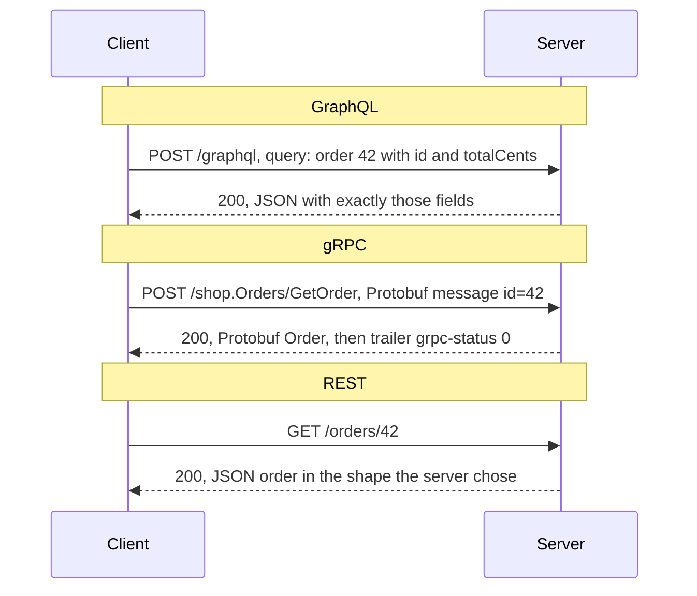

# API styles: GraphQL, gRPC, REST

## The problem
A client asks a server for work and waits for the answer. This is [request-response](00-overview.md).
An API (Application Programming Interface) style is the shape of those calls: how you name the work, and what the answer looks like. The term is ours; the sources don't define it.

Two terms first:
- **HTTP API**: any API whose messages travel over HTTP (Hypertext Transfer Protocol). All three styles below can run over HTTP, so this is the umbrella, not an option. [OpenAPI §2]
- **REST (Representational State Transfer), strictly**: Roy Fielding, who defined REST, says an API not driven by links in its responses "cannot be RESTful". Many APIs called REST skip the links. This page uses "REST" in the everyday sense. [Fielding 2008]

## The options

### GraphQL
- **In real life:** you tell the waiter "just the salad, no bread", and the plate comes back with exactly that.
- **What it is:** "a query language and execution engine". The client sends one document to one endpoint, usually `/graphql`, and names the fields it wants. [GraphQL spec, Introduction; graphql.org, Serving over HTTP]
- **Pros:** the answer holds exactly the requested fields, "avoiding over-fetching and under-fetching". One typed schema that clients can query. New fields need no new version. [GraphQL spec §2.5, §4; graphql.org, Schema Design]
- **Cons:** a naive server makes one data call for a list, then one more per item (the N+1 problem). Public APIs need depth, breadth and rate limits. Most HTTP caches skip POST. [graphql.org, Performance; graphql.org, Security; RFC 9110 §9.2.3]
- **Use when:** front ends need flexible data shapes, or one gateway sits in front of many services. [GraphQL spec §1; graphql.org FAQ]

### gRPC
- **In real life:** you and the kitchen share a printed order pad. Its boxes are numbered, not labeled, so orders are quick to write and read, but hard to read without the key (the `.proto` file).
- **What it is:** an RPC (Remote Procedure Call) framework. The client calls a server method "as if it were a local object", over HTTP/2, with Protobuf (Protocol Buffers) messages by default. The name stands for "gRPC Remote Procedure Calls". [grpc.io Introduction; grpc.io FAQ]
- **Pros:** one `.proto` file generates clients and servers in many languages. Four call kinds: unary, server streaming, client streaming, bidirectional. Deadlines and cancellation are built in. [grpc.io Python Basics; grpc.io Core concepts]
- **Cons:** browsers need gRPC-Web and a proxy, without client or bidirectional streaming. A message can't be fully read without its `.proto` file: the bytes hold field numbers, not names. No deadline unless you set one. [grpc-web README; protobuf.dev Overview; protobuf.dev Encoding; grpc.io Deadlines]
- **Use when:** services in many languages talk to each other, or mobile clients talk to cloud servers. [grpc.io About; grpc.io FAQ]

### REST
- **In real life:** a menu where every dish has its own number. You name the dish and what to do with it (order it, cancel it). You can pick options the menu lists, like query parameters, but the kitchen decides how to plate it.
- **What it is:** REST is an architectural style. Each resource has a URI (Uniform Resource Identifier); clients use standard HTTP methods such as GET and POST on it. [Fielding 2000 ch. 5; RFC 9110 §9.1]
- **Pros:** browsers, proxies and shared caches can store GET responses. Standard methods tell clients which requests are safe to retry. FastAPI generates an OpenAPI contract at `/openapi.json`. [RFC 9111 §2; RFC 9110 §9.2.2; FastAPI First Steps]
- **Cons:** the standard form "degrades efficiency". The server decides the shape of each response. It is pull-only, so watching for changes costs more. [Fielding 2000 §5.1.5, §5.4; GraphQL spec §1]
- **Use when:** many independent clients, browsers or public users call you, and caching helps. [Fielding 2000 §5.5, §6.5.2]

### Also in this group
- **JSON-RPC 2.0**: a small RPC protocol that uses JSON (JavaScript Object Notation) and works over any transport. [JSON-RPC 2.0 §1]
- **SOAP** (no longer an acronym): a protocol for structured messages in XML (Extensible Markup Language), over many transports. Reliable delivery is a separate spec, WS-ReliableMessaging (Web Services Reliable Messaging). [SOAP 1.2 Part 1, Abstract, §1; WS-RM 1.2]

### MCP (Model Context Protocol)
- **In real life:** MCP's own docs compare it to "a USB-C port for AI applications": one standard plug between AI (artificial intelligence) apps and outside tools. [MCP docs, What is MCP?] USB is Universal Serial Bus.
- **What it is:** "an open protocol that enables seamless integration between LLM applications and external data sources and tools". An LLM is a large language model. [MCP spec, Overview]
- **How it works:** JSON-RPC 2.0 messages between a host (the AI app), its clients (connectors) and servers (which offer tools and data). [MCP spec, Overview]
- **Transports:** stdio (standard input and output), where the app starts the server as a local process, and Streamable HTTP, where each message is an HTTP POST to one endpoint, and replies come back as JSON or an SSE (Server-Sent Events) stream. [MCP Transports]
- **Build an MCP server when:** you want AI apps to use your service's tools or data. [MCP spec, Overview]
- **Why it's not in the table:** MCP connects AI apps to tools. It is not a general way for any client to call any backend.

## Compare

### Design
| | GraphQL | gRPC | REST |
|---|---|---|---|
| What you design | Types and fields, e.g. `Order.totalCents` | Services and methods, e.g. `Orders.GetOrder` | Resources and methods, e.g. `GET /orders/42` |
| Contract | A schema; clients can read it (introspection) | A `.proto` file; client and server code are generated from it | None built in; FastAPI generates OpenAPI at `/openapi.json` |
| Payload | JSON is most common | Protobuf (binary) by default | Any; FastAPI uses JSON |
| Response shape | The client picks the fields | Fixed by the message | The server decides |
| Call types | Query, mutation, subscription | Unary, server streaming, client streaming, bidirectional | One request, one response; add SSE for push |
| Changing the API | Add fields, mark old ones `@deprecated`; avoid versions | Add fields with new numbers; never reuse a number | No standard: Google puts `v1` in the path, Azure uses `?api-version=` |

### Run
| | GraphQL | gRPC | REST |
|---|---|---|---|
| Transport | Any; HTTP is most common | HTTP/2 | HTTP in practice |
| From a browser | Plain HTTP | gRPC-Web plus a proxy | Native |
| Errors | An `errors` list in the body; partial data possible | A code such as `NOT_FOUND` in trailers; HTTP status 200 | An HTTP status such as `404` |
| Auth | HTTP middleware, before GraphQL runs | Metadata (gRPC's headers): `authorization: Bearer <token>` | A header: `Authorization: Bearer <token>` |
| Timeouts | Same as REST | A deadline, sent to the server; none by default | Set in the HTTP client: HTTPX defaults to 5 s without data, Requests to no limit |
| HTTP caching | With GET and persisted documents | Not by generic caches (all POST) | GET responses |
| Debugging | GraphiQL in the browser (Strawberry serves it) | `grpcurl`, which asks the server for its API (server reflection) or reads the `.proto` file | `curl` or the browser |
| Health checks | Same as REST | A standard service, `grpc.health.v1.Health` | No standard; Kubernetes examples use `/healthz` |
| Python library | Strawberry | `grpcio`, `grpcio-tools` | FastAPI |

Every cell is cited in the research note, [§5](../../research/api-styles.md#5-side-by-side) and [§9](../../research/api-styles.md#9-rework-facts-2026-11-23-more-compare-rows-snippets-analogies).

## Surprises
- GraphQL can be cached: send queries with GET and use persisted documents (a stored query, sent as a hash). [graphql.org, Performance]
- gRPC answers HTTP 200 even when a call fails. The real status travels in trailers. [gRPC HTTP/2 protocol, "Responses"]
- In Protobuf, the field number is the contract, not the name: the binary bytes carry only numbers. "Changing the field number is equivalent to deleting the field and adding a new field with the same type." Names travel only in JSON and text format, so a rename breaks old readers there, and code that uses the old name must change. [protobuf.dev Encoding; protobuf.dev proto3 guide; protobuf.dev Proto Best Practices]
- REST does not require JSON. Neither Fielding nor the HTTP spec requires it; a representation can be an HTML page or a JPEG image. [Fielding 2000 §5.2.1; RFC 9110 §3.2]
- One service can offer more than one style. GitHub runs a REST API and a GraphQL API side by side. [GitHub REST docs; GitHub GraphQL docs]

## Same call, three ways
On the wire, "get order 42" looks like this:



In the server, each snippet follows its library's official tutorial, and each one was run. Install `"fastapi[standard]" "strawberry-graphql[fastapi]" grpcio grpcio-tools`. Start the FastAPI apps with `fastapi dev <file>`, and the gRPC server with `python grpc_server.py`. [FastAPI First Steps; FastAPI Path Parameters; grpc.io Python Basics; Strawberry FastAPI integration]

**GraphQL** with Strawberry. Fields use `async def`, because Strawberry runs every field on the event loop. `total_cents` becomes `totalCents` in the schema. [Strawberry FastAPI integration; Strawberry Schema Configurations]
```python
import strawberry
from fastapi import FastAPI
from strawberry.fastapi import GraphQLRouter

@strawberry.type
class Order:
    id: int
    total_cents: int

@strawberry.type
class Query:
    @strawberry.field
    async def order(self, id: int) -> Order:
        return Order(id=id, total_cents=1050)

app = FastAPI()
app.include_router(GraphQLRouter(strawberry.Schema(query=Query)), prefix="/graphql")
```
Call it: `curl -X POST localhost:8000/graphql -H 'Content-Type: application/json' -d '{"query": "{ order(id: 42) { id totalCents } }"}'`

**gRPC** with `grpcio`. First the contract, `shop.proto`:
```protobuf
syntax = "proto3";
package shop;

service Orders {
  rpc GetOrder (GetOrderRequest) returns (Order);
}

message GetOrderRequest { int32 id = 1; }
message Order { int32 id = 1; int32 total_cents = 2; }
```
`python -m grpc_tools.protoc -I. --python_out=. --pyi_out=. --grpc_python_out=. shop.proto` generates `shop_pb2.py` and `shop_pb2_grpc.py`. Then the server:
```python
from concurrent import futures
import grpc
import shop_pb2
import shop_pb2_grpc

class Orders(shop_pb2_grpc.OrdersServicer):
    def GetOrder(self, request, context):
        return shop_pb2.Order(id=request.id, total_cents=1050)

def serve(port=50051):
    server = grpc.server(futures.ThreadPoolExecutor(max_workers=10))
    shop_pb2_grpc.add_OrdersServicer_to_server(Orders(), server)
    server.add_insecure_port(f"[::]:{port}")
    server.start()
    return server

if __name__ == "__main__":
    serve().wait_for_termination()
```
Call it from Python, with a 2-second deadline:
```python
with grpc.insecure_channel("localhost:50051") as channel:
    print(shop_pb2_grpc.OrdersStub(channel).GetOrder(shop_pb2.GetOrderRequest(id=42), timeout=2))
```

**REST** with FastAPI:
```python
from fastapi import FastAPI

app = FastAPI()

@app.get("/orders/{order_id}")
async def get_order(order_id: int):
    return {"id": order_id, "total_cents": 1050}
```
Call it: `curl localhost:8000/orders/42`

## Try it
```bash
python3 examples/communication/request_payload_size.py
```
It prints `JSON: 143 bytes` and `Protobuf: 40 bytes` for the same order with two items. See [request_payload_size.py](../../../examples/communication/request_payload_size.py); the schema is a comment at the top.
- This is one order, uncompressed. It is not a benchmark.
- The counts are message bodies only. gRPC adds a 5-byte prefix to each message, and HTTP adds headers. [gRPC HTTP/2 protocol, "Requests"]
- Protobuf is not always smaller: a field holding `-2` as an `int32` takes 11 bytes (1 tag byte plus a 10-byte value). `{"a":-2}` in JSON takes 8. [protobuf.dev Encoding, "Signed Integers"]
- JSON compresses well with gzip; Protobuf does not compress itself. [graphql.org, Performance; protobuf.dev Overview]
- Real projects use the `protobuf` library and a `.proto` file. The example writes the bytes by hand so you can see them.

## Remember
- GraphQL lets the client name fields, gRPC names methods, and REST names resources.
- Each one has a cost: GraphQL needs limits on queries, gRPC needs a proxy in browsers, and REST gives up some efficiency.
- "HTTP API" is the umbrella; all three can run over HTTP.

## Sources
- [Fielding 2000, chapter 5: REST](https://ics.uci.edu/~fielding/pubs/dissertation/rest_arch_style.htm) and [Fielding 2008: REST APIs must be hypertext-driven](https://roy.gbiv.com/untangled/2008/rest-apis-must-be-hypertext-driven)
- [RFC 9110: HTTP semantics](https://www.rfc-editor.org/rfc/rfc9110), [RFC 9111: HTTP caching](https://www.rfc-editor.org/rfc/rfc9111), [RFC 6750: Bearer tokens](https://www.rfc-editor.org/rfc/rfc6750)
- [OpenAPI Specification](https://spec.openapis.org/oas/latest.html), [FastAPI: First Steps](https://fastapi.tiangolo.com/tutorial/first-steps/), [Path Parameters](https://fastapi.tiangolo.com/tutorial/path-params/)
- [grpc.io: Introduction](https://grpc.io/docs/what-is-grpc/introduction/), [Core concepts](https://grpc.io/docs/what-is-grpc/core-concepts/), [About](https://grpc.io/about/), [FAQ](https://grpc.io/docs/what-is-grpc/faq/), [Python Basics](https://grpc.io/docs/languages/python/basics/)
- grpc.io guides: [Deadlines](https://grpc.io/docs/guides/deadlines/), [Status codes](https://grpc.io/docs/guides/status-codes/), [Metadata](https://grpc.io/docs/guides/metadata/), [Health checking](https://grpc.io/docs/guides/health-checking/), [Reflection](https://grpc.io/docs/guides/reflection/)
- [gRPC over HTTP/2 protocol](https://github.com/grpc/grpc/blob/master/doc/PROTOCOL-HTTP2.md), [grpc-web README](https://github.com/grpc/grpc-web), [grpcurl README](https://github.com/fullstorydev/grpcurl)
- [protobuf.dev: Overview](https://protobuf.dev/overview/), [Encoding](https://protobuf.dev/programming-guides/encoding/), [proto3 guide](https://protobuf.dev/programming-guides/proto3/), [Proto Best Practices](https://protobuf.dev/best-practices/dos-donts/)
- [GraphQL specification, September 2026](https://spec.graphql.org/September2026/)
- [graphql.org: Serving over HTTP](https://graphql.org/learn/serving-over-http/), [Performance](https://graphql.org/learn/performance/), [Security](https://graphql.org/learn/security/), [Schema Design](https://graphql.org/learn/schema-design/), [Authorization](https://graphql.org/learn/authorization/), [Introspection](https://graphql.org/learn/introspection/), [FAQ](https://graphql.org/faq/)
- [Strawberry: FastAPI integration](https://strawberry.rocks/docs/integrations/fastapi) and [Schema Configurations](https://strawberry.rocks/docs/types/schema-configurations)
- [HTTPX: Timeouts](https://www.python-httpx.org/advanced/timeouts/), [Requests: Timeouts](https://requests.readthedocs.io/en/latest/user/advanced/), [Kubernetes: Probes](https://kubernetes.io/docs/tasks/configure-pod-container/configure-liveness-readiness-startup-probes/)
- [Google AIP-185: API versioning](https://google.aip.dev/185) and [Azure REST API Guidelines](https://github.com/microsoft/api-guidelines/blob/vNext/azure/Guidelines.md)
- [JSON-RPC 2.0](https://www.jsonrpc.org/specification), [SOAP 1.2 Part 1](https://www.w3.org/TR/soap12-part1/), [WS-ReliableMessaging 1.2](http://docs.oasis-open.org/ws-rx/wsrm/200702/wsrm-1.2-spec-os.html)
- [MCP: What is MCP?](https://modelcontextprotocol.io/docs/getting-started/intro), [MCP specification](https://modelcontextprotocol.io/specification/latest), [MCP transports](https://modelcontextprotocol.io/specification/latest/basic/transports)
- [GitHub REST API docs](https://docs.github.com/en/rest) and [GitHub GraphQL API docs](https://docs.github.com/en/graphql)
- Full research notes: [api-styles.md](../../research/api-styles.md) and [communication-styles.md](../../research/communication-styles.md)
