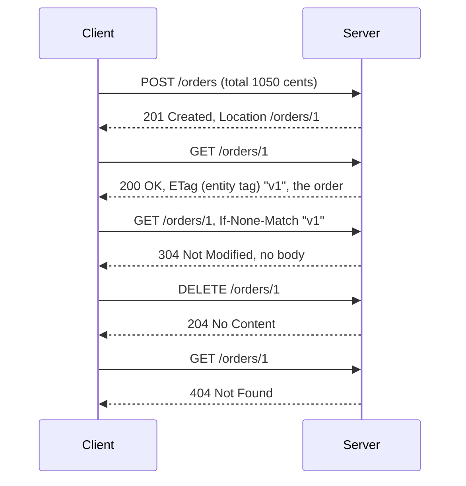

# REST

## The problem
Many clients, built by different teams, need to read and change the same data over HTTP (Hypertext Transfer Protocol).
REST (Representational State Transfer) gives such an API (Application Programming Interface) one uniform interface that every client already knows.
- **In real life:** a menu where every dish has its own number. You name the dish and what to do with it (order it, cancel it). You can pick options the menu lists, like query parameters, but the kitchen decides how to plate it.

For REST next to GraphQL and gRPC, see [API styles](01-api-styles.md).

## The picture



## How it works
1. **Resources.** Anything that can be named is a resource, such as order 1. A URI (Uniform Resource Identifier) like `http://localhost:8000/orders/1` identifies it; `/orders/1` is its path.
2. **Representations.** The server sends a representation: bytes that show the resource's state, in a media type such as JSON (JavaScript Object Notation). REST does not require JSON; a web page or an image works too.
3. **Methods.** The method says what to do with the resource. A safe method only reads. An idempotent method has the same effect sent once or twice, so a client can repeat it after a dropped connection.

| Method | What it asks | Safe | Idempotent |
|---|---|---|---|
| GET | Send me the resource | Yes | Yes |
| POST | Process this, e.g. create a new order | No | No |
| PUT | Create or replace the whole resource | No | Yes |
| PATCH | Change part of it | No | No |
| DELETE | Remove it | No | Yes |

4. **Status codes.** The first digit gives the class: 2xx success, 3xx redirection, 4xx client error, 5xx server error. A client that meets an unknown code treats it as the class's x00 code.
   - Success: 200 OK, 201 Created (a `Location` header can name the new resource), 204 No Content.
   - Caching: 304 Not Modified.
   - Client errors: 400 Bad Request, 401 Unauthorized (with a `WWW-Authenticate` header), 404 Not Found, 422 Unprocessable Content. FastAPI answers 422 when input fails validation.
   - Server error: 500 Internal Server Error.
5. **Stateless.** Each request carries everything the server needs, credentials included, such as `Authorization: Bearer <token>`. The server keeps no session between requests. That helps scaling, but repeats data in every request.
6. **Caching.** A GET response can be stored and reused. `Cache-Control: max-age=60` keeps it fresh for 60 seconds. An `ETag` (entity tag) labels its version; the client sends that label back in `If-None-Match`, and if nothing changed the server answers 304 with no body.
7. **Contract.** REST itself has no contract file. FastAPI generates an OpenAPI description at `/openapi.json` and an interactive page at `/docs`, and client code can be generated from it.
8. **Changing the API.** No standard says how to version. [Google](https://google.aip.dev/185) puts `v1` in the path; [Azure](https://github.com/microsoft/api-guidelines/blob/vNext/azure/Guidelines.md) uses `?api-version=`. FastAPI marks an old route with `deprecated=True`, and `/docs` shows it as deprecated.
9. **Push.** REST is pull: the client asks each time. For server push over plain HTTP there is SSE (Server-Sent Events), which FastAPI has built in.
10. **Strict REST.** Roy Fielding, who defined REST, says [a REST API must be hypertext-driven](https://roy.gbiv.com/untangled/2008/rest-apis-must-be-hypertext-driven): clients follow links in responses instead of building URIs themselves. Most APIs called REST skip the links, and so does our example. The next section compares the two.

### Strict REST vs everyday REST
- **Strict REST** (Fielding's): each response links to what the client can do next, so the client only needs the first URL. This rule is called HATEOAS (Hypermedia as the Engine of Application State).
- **Everyday REST:** resources, methods and status codes, but no links. The client builds URLs from the docs. Microsoft notes that [many published web APIs](https://learn.microsoft.com/en-us/azure/architecture/best-practices/api-design#web-api-maturity-model) work this way.
- **In real life:** strict REST is browsing a website: you click links and never type an address. Everyday REST is a list of saved addresses: if the site moves a page, a saved address breaks.

A strict REST response for order 1 might look like this. No standard says how to write the links.

```json
{"id": 1, "total_cents": 1050,
 "links": {"self": "/orders/1", "payment": "/orders/1/payment"}}
```

| | Strict REST (links) | Everyday REST (no links) |
|---|---|---|
| Pros | The server can change its URLs without breaking clients. Links show what the client can do next, and new links announce new features. | Simpler to build. OpenAPI and its tools support it fully. |
| Cons | No standard format for links. A link doesn't say which method to use, so clients still need the docs. Clients can still hard-code URLs. | Clients build URLs from the docs, so changing a URL breaks them. Not REST by Fielding's definition. |
| Use when | Human-facing apps, and public APIs whose URLs may change. [GitHub's REST API](https://docs.github.com/en/rest/using-the-rest-api/getting-started-with-the-rest-api#hypermedia) adds `*_url` fields so clients don't build URLs. | Service-to-service APIs described in an OpenAPI file. [Zalando's API guidelines](https://opensource.zalando.com/restful-api-guidelines/) require this level. |

Why most APIs skip the links: Zalando's guidelines say links add complexity "without real value" in their setting, where client developers read the API reference anyway. [Martin Fowler](https://martinfowler.com/articles/richardsonMaturityModel.html) explains the same levels with examples.

## In our code
A FastAPI app that creates, reads, replaces and deletes orders, kept in memory. It sends no `ETag`, so it never answers 304.

<details>
<summary>Code: <code>rest_orders.py</code></summary>

```python
from itertools import count
from fastapi import FastAPI, HTTPException, Response
from pydantic import BaseModel

app = FastAPI()
orders, ids = {}, count(1)

class OrderIn(BaseModel):
    total_cents: int

@app.post("/orders", status_code=201)
async def create_order(order: OrderIn, response: Response):
    order_id = next(ids)
    orders[order_id] = order.total_cents
    response.headers["Location"] = f"/orders/{order_id}"
    return {"id": order_id, "total_cents": order.total_cents}

@app.get("/orders/{order_id}")
async def get_order(order_id: int):
    if order_id not in orders:
        raise HTTPException(status_code=404, detail="Order not found")
    return {"id": order_id, "total_cents": orders[order_id]}

@app.put("/orders/{order_id}")
async def replace_order(order_id: int, order: OrderIn):
    orders[order_id] = order.total_cents
    return {"id": order_id, "total_cents": order.total_cents}

@app.delete("/orders/{order_id}", status_code=204)
async def delete_order(order_id: int):
    if orders.pop(order_id, None) is None:
        raise HTTPException(status_code=404, detail="Order not found")
```

</details>

## Try it
Install `"fastapi[standard]"` and start the app with `fastapi dev rest_orders.py`. Then create an order, delete it, and read it again:

```bash
curl -s -w ' %{http_code}\n' -X POST localhost:8000/orders -H 'Content-Type: application/json' -d '{"total_cents": 1050}'
curl -s -w '%{http_code}\n' -X DELETE localhost:8000/orders/1
curl -s -w ' %{http_code}\n' localhost:8000/orders/1
```

Output:

```text
{"id":1,"total_cents":1050} 201
204
{"detail":"Order not found"} 404
```

## Remember
- A URI names a resource; the method says what to do with it.
- GET only reads. GET, PUT and DELETE are idempotent, so a client may repeat them.
- The status code's first digit tells the client what happened, even for a code it does not know.

## Sources
- [Fielding 2000, chapter 5: REST](https://ics.uci.edu/~fielding/pubs/dissertation/rest_arch_style.htm) and [Fielding 2008: REST APIs must be hypertext-driven](https://roy.gbiv.com/untangled/2008/rest-apis-must-be-hypertext-driven)
- [RFC 9110: HTTP semantics](https://www.rfc-editor.org/rfc/rfc9110), [RFC 9111: HTTP caching](https://www.rfc-editor.org/rfc/rfc9111), [RFC 5789: PATCH](https://www.rfc-editor.org/rfc/rfc5789), [RFC 6750: Bearer tokens](https://www.rfc-editor.org/rfc/rfc6750)
- [HTML: Server-sent events](https://html.spec.whatwg.org/multipage/server-sent-events.html)
- FastAPI: [First Steps](https://fastapi.tiangolo.com/tutorial/first-steps/), [Response Status Code](https://fastapi.tiangolo.com/tutorial/response-status-code/), [Handling Errors](https://fastapi.tiangolo.com/tutorial/handling-errors/), [Response Headers](https://fastapi.tiangolo.com/advanced/response-headers/), [Path Operation Configuration](https://fastapi.tiangolo.com/tutorial/path-operation-configuration/), [Generate Clients](https://fastapi.tiangolo.com/advanced/generate-clients/), [Server-Sent Events](https://fastapi.tiangolo.com/tutorial/server-sent-events/)
- [Google AIP-185: API versioning](https://google.aip.dev/185) and [Azure REST API Guidelines](https://github.com/microsoft/api-guidelines/blob/vNext/azure/Guidelines.md)
- Strict vs everyday REST: [Martin Fowler: Richardson Maturity Model](https://martinfowler.com/articles/richardsonMaturityModel.html), [Microsoft Learn: Web API design](https://learn.microsoft.com/en-us/azure/architecture/best-practices/api-design), [Zalando RESTful API Guidelines](https://opensource.zalando.com/restful-api-guidelines/), [GitHub Docs: Hypermedia](https://docs.github.com/en/rest/using-the-rest-api/getting-started-with-the-rest-api#hypermedia)
- Full research note: [api-styles.md](../../research/api-styles.md), §2, §9, §10 and §11
