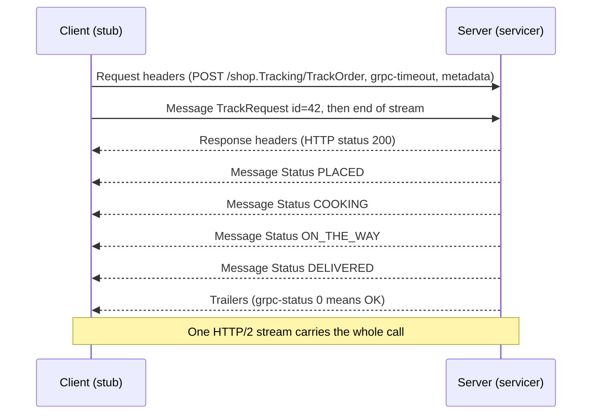

# gRPC

## The problem
One service needs to call a function on another service, on another machine, as easily as a local function. That is an RPC (Remote Procedure Call). [grpc.io Introduction to gRPC, "Overview"]
RPC is a family of protocols, not one protocol: ONC (Open Network Computing) RPC and gRPC ("gRPC Remote Procedure Calls") both describe themselves as RPC protocols. [RFC 5531; grpc.io FAQ] Google built gRPC and open-sourced it in 2015. [grpc.io About]
It sends calls over HTTP (Hypertext Transfer Protocol) version 2, written HTTP/2, and its API (Application Programming Interface) is written down in a `.proto` file. [grpc.io Introduction to gRPC; gRPC HTTP/2 protocol]
- **In real life:** you and the kitchen share a printed order pad. Its boxes are numbered, not labeled, so orders are quick to write and read, but hard to read without the key (the `.proto` file).

For gRPC next to GraphQL and REST (Representational State Transfer), see [API styles](01-api-styles.md). [REST](02-rest.md) explains the HTTP basics this page builds on.

## The picture



## How it works
1. **The contract.** You describe the service and its messages in a `.proto` file, in Protobuf (Protocol Buffers). Each field has a number, and the number, not the name, identifies the field on the wire. Never reuse a number. [grpc.io Introduction to gRPC; protobuf.dev Encoding; protobuf.dev proto3 guide]
2. **Generated code.** `protoc` (the Protobuf compiler) with the gRPC plugin turns the `.proto` file into code. In Python, a service `Tracking` gives `TrackingStub` for the client, `TrackingServicer` for the server, and `add_TrackingServicer_to_server` to register it. [grpc.io Introduction to gRPC; grpc.io Python Quick start; grpc.io Python Generated-code reference]
3. **Stubs.** The client calls the stub like a local object. The stub wraps the arguments in a Protobuf message and sends it. [grpc.io Introduction to gRPC, "Overview"; grpc.io Core concepts, "Using the API"]
4. **Four call types.** Unary (one request, one response), server streaming (one request, many responses), client streaming (many requests, one response) and bidirectional streaming. Messages keep their order within a call. [grpc.io Core concepts, "Service definition"]
5. **Streaming in Python.** A server-streaming method is a generator that yields each response. The client loops over the call, and each step waits for the next message. [grpc.io Python Basics, "Response-streaming RPC", "Calling service methods"]
6. **On the wire.** Every call is an HTTP/2 POST to `/<package>.<Service>/<Method>`. Each message gets a 5-byte prefix: a compression flag and a length. The HTTP status is 200; the gRPC status travels in trailers, as `grpc-status` and `grpc-message`, even when the call succeeds. [gRPC HTTP/2 protocol, "Requests", "Responses"]
7. **Metadata.** Key-value pairs about one call, such as `authorization: Bearer <token>`. They travel as HTTP/2 headers. [grpc.io Core concepts, "Metadata"; grpc.io Metadata guide, "Headers"; gRPC HTTP/2 protocol, "Requests"]
8. **Deadlines and cancellation.** The client says how long it will wait, sent as `grpc-timeout`. There is no deadline by default, so always set one. When it passes, the call ends with `DEADLINE_EXCEEDED` and the server cancels its side, but a long-running handler must check for cancellation itself. Either side can also cancel early; work done before that is not rolled back. [grpc.io Deadlines guide; grpc.io Cancellation guide; gRPC HTTP/2 protocol, "Requests"; grpc.io Core concepts, "Cancelling an RPC"]
9. **Status codes.** There are 17, from 0 `OK` to 16 `UNAUTHENTICATED`. Every call ends with one code and an optional message. `NOT_FOUND` and six others come only from your code, never from the gRPC library. [gRPC status codes doc; grpc.io Status Codes guide]
10. **Retries.** Retries are enabled by default, but there is no default retry policy; you set one per method in the service config (client settings that the service owner provides). Calls are not assumed idempotent. [grpc.io Retry guide; grpc.io Service Config guide; gRPC HTTP/2 protocol, "Idempotency and Retries"]
11. **Health and debugging.** A standard service, `grpc.health.v1.Health`, answers health checks. With server reflection on, `grpcurl` can list and call methods without the `.proto` file. [grpc.io Health checking guide; grpc.io Reflection guide; grpcurl README]
12. **Browsers.** A browser cannot make gRPC calls directly. It needs gRPC-Web plus a proxy, which supports unary calls and, in one mode, server streaming. [grpc-web README, "Streaming Support"]

## In our code
An order-tracking service. The client asks about order 42, and the server streams four statuses, one a second. The client sets a 10-second deadline; in our test, a 0.2-second deadline ended the same stream with `DEADLINE_EXCEEDED`.

<details>
<summary>Code: <code>track.proto</code> and the command that generates Python from it</summary>

```protobuf
syntax = "proto3";
package shop;

service Tracking {
  rpc TrackOrder (TrackRequest) returns (stream Status);
}

message TrackRequest { int32 id = 1; }
message Status { string state = 1; }
```

```bash
python -m grpc_tools.protoc -I. --python_out=. --pyi_out=. --grpc_python_out=. track.proto
```

</details>

<details>
<summary>Code: <code>grpc_track_server.py</code></summary>

```python
import time
from concurrent import futures
import grpc
import track_pb2
import track_pb2_grpc

STATES = ["PLACED", "COOKING", "ON_THE_WAY", "DELIVERED"]

class Tracking(track_pb2_grpc.TrackingServicer):
    def __init__(self, delay):
        self.delay = delay

    def TrackOrder(self, request, context):
        for state in STATES:
            time.sleep(self.delay)
            yield track_pb2.Status(state=state)

def serve(port=50051, delay=1.0):
    server = grpc.server(futures.ThreadPoolExecutor(max_workers=10))
    track_pb2_grpc.add_TrackingServicer_to_server(Tracking(delay), server)
    server.add_insecure_port(f"[::]:{port}")
    server.start()
    return server

if __name__ == "__main__":
    serve().wait_for_termination()
```

</details>

<details>
<summary>Code: <code>grpc_track_client.py</code></summary>

```python
import grpc
import track_pb2
import track_pb2_grpc

with grpc.insecure_channel("localhost:50051") as channel:
    stub = track_pb2_grpc.TrackingStub(channel)
    for status in stub.TrackOrder(track_pb2.TrackRequest(id=42), timeout=10):
        print(status.state)
```

</details>

## Try it
Install `grpcio grpcio-tools` and generate the code (the command above). Start the server with `python grpc_track_server.py`, then in a second terminal run the client: [grpc.io Python Quick start]

```bash
python grpc_track_client.py
```

Output, one line a second:

```text
PLACED
COOKING
ON_THE_WAY
DELIVERED
```

## Remember
- The `.proto` file is the contract. Field numbers, not names, travel on the wire.
- The HTTP status is 200 even when a call fails; read `grpc-status` in the trailers.
- Always set a deadline: without one, a call can wait forever.

## Sources
- grpc.io: [Introduction to gRPC](https://grpc.io/docs/what-is-grpc/introduction/), [Core concepts](https://grpc.io/docs/what-is-grpc/core-concepts/), [About](https://grpc.io/about/), [FAQ](https://grpc.io/docs/what-is-grpc/faq/), [Python Quick start](https://grpc.io/docs/languages/python/quickstart/), [Python Basics](https://grpc.io/docs/languages/python/basics/), [Python Generated-code reference](https://grpc.io/docs/languages/python/generated-code/)
- grpc.io guides: [Deadlines](https://grpc.io/docs/guides/deadlines/), [Cancellation](https://grpc.io/docs/guides/cancellation/), [Retry](https://grpc.io/docs/guides/retry/), [Service Config](https://grpc.io/docs/guides/service-config/), [Metadata](https://grpc.io/docs/guides/metadata/), [Status codes](https://grpc.io/docs/guides/status-codes/), [Health checking](https://grpc.io/docs/guides/health-checking/), [Reflection](https://grpc.io/docs/guides/reflection/)
- [gRPC over HTTP/2 protocol](https://github.com/grpc/grpc/blob/master/doc/PROTOCOL-HTTP2.md), [gRPC status codes](https://github.com/grpc/grpc/blob/master/doc/statuscodes.md), [grpc-web README](https://github.com/grpc/grpc-web), [grpcurl README](https://github.com/fullstorydev/grpcurl)
- [protobuf.dev: Encoding](https://protobuf.dev/programming-guides/encoding/) and [proto3 guide](https://protobuf.dev/programming-guides/proto3/)
- [RFC 5531: RPC](https://www.rfc-editor.org/rfc/rfc5531)
- Full research notes: [api-styles.md](../../research/api-styles.md), §3, §9 and §10, and [communication-styles.md](../../research/communication-styles.md)
